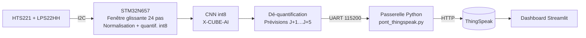
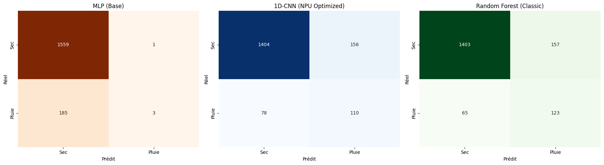

# 🌦️ Oracle Météo — Prévisions à 5 jours par IA embarquée sur STM32N6

> Un réseau de neurones convolutif **quantifié int8 (13 Ko)** qui prédit température, humidité, pression et risque de pluie de J+1 à J+5 **directement sur microcontrôleur**, à partir de capteurs I2C. Sans cloud pour l'inférence.


Projet du module *« Systèmes embarqués et IA au plus près des capteurs »*, Université Savoie Mont Blanc (2026).

🔗 **[Dashboard en ligne](https://oracle-meteo-usmb.streamlit.app/)** · 📄 **[Rapport complet (PDF)](Station_meteo_IA/docs/Rapport.pdf)**

---

## En bref

| | |
|---|---|
| **Cible** | STM32N657 (Arm Cortex-M55), inférence sur CPU via X-CUBE-AI |
| **Capteurs** | HTS221 (température, humidité) · LPS22HH (pression), bus I2C |
| **Modèle** | CNN 1D, entrée `[24 h × 3 grandeurs]` → sortie `[5 jours × 4 grandeurs]` |
| **Optimisation** | Quantification post-entraînement int8 → **13 Ko** (`.tflite`) |
| **Données** | Historique horaire [Meteostat](https://meteostat.net), 2021-2023 |
| **Chaîne IoT** | UART → passerelle Python → ThingSpeak → dashboard Streamlit |

## Architecture



## Ce que fait le firmware

1. **Acquisition** des capteurs en I2C (pilotes ST), avec conversion à partir des **coefficients de calibration usine** du HTS221.
2. **Fenêtre glissante** de 24 pas × 3 grandeurs conservée en RAM.
3. **Prétraitement embarqué** : normalisation Min-Max (mêmes bornes qu'à l'entraînement), saturation, puis quantification int8 avec l'échelle et le *zero-point* du modèle TFLite.
4. **Inférence** du CNN via X-CUBE-AI (activations placées en AXI-SRAM).
5. **Post-traitement** : dé-quantification et dé-normalisation des 20 sorties, envoi des prévisions sur l'UART.

Code : [`firmware/main.c`](Station_meteo_IA/firmware/main.c) (acquisition) et [`firmware/app_x-cube-ai.c`](Station_meteo_IA/firmware/app_x-cube-ai.c) (pré/post-traitement et inférence).

## Le modèle

```
Input (24, 3) → Conv1D 32, k=3, ReLU → MaxPool 2 → Conv1D 16, k=3, ReLU
             → Flatten → Dense 64, ReLU → Dense 20, Sigmoid
```

- Tâche mixte : **régression** (T, HR, P moyennes par jour) + **probabilité de pluie** (classification binaire).
- Le CNN 1D a été choisi pour capter les motifs temporels (cycle jour/nuit, chute de pression) avec beaucoup moins de paramètres qu'un LSTM, ce qui compte sur microcontrôleur.
- Comparaison avec un MLP et une forêt aléatoire documentée dans le notebook :



Détails : [rapport d'architecture du modèle](Station_meteo_IA/models/rapport_modele_ia.md) · [courbes de fiabilité](Station_meteo_IA/models/README.md) · [notebook d'entraînement](Station_meteo_IA/notebook/model_Oracle.ipynb)

## Sobriété énergétique

Une [étude de consommation](Station_meteo_IA/bilan_energetique.md) estime le profil d'un cycle mesure + inférence toutes les 15 min avec mise en veille profonde entre deux cycles : **≈ 10 µA en moyenne (estimation théorique)**, l'inférence int8 représentant environ un quart de la charge consommée. Le document propose aussi le protocole de mesure (shunt + oscilloscope, ou X-NUCLEO-LPM01A).

## Limites connues et pistes d'amélioration

Je préfère les lister clairement :

- **Démo vs usage réel** : dans la version actuelle, la fenêtre avance à chaque boucle (1 s) pour la démonstration, alors que le modèle attend un pas **horaire**. Prochaine étape : cadencement par RTC + mode Stop entre deux mesures, ce qui permettra aussi de **mesurer** réellement la consommation estimée ci-dessus.
- **Données d'entraînement** : le modèle a été entraîné sur une seule station Meteostat (Francfort, ID 10637). Un ré-entraînement sur une station locale (Alpes) améliorerait la pertinence.
- **Pluie** : classe minoritaire (~10 % des heures), la détection reste perfectible (F1 ≈ 0,48 pour le CNN sur la tâche pluie seule, contre 0,53 pour une forêt aléatoire, voir notebook).
- **NPU non exploité** : l'inférence tourne sur le Cortex-M55 ; porter le modèle sur l'accélérateur **Neural-ART** du STM32N6 et comparer latence/énergie CPU vs NPU est la suite logique.

## Structure du dépôt

```
Station_meteo_IA/
├── firmware/      Code C STM32CubeIDE : acquisition, pré/post-traitement, inférence X-CUBE-AI
├── models/        Modèle .tflite int8, schéma, courbes et rapport d'architecture
├── notebook/      Entraînement, quantification, comparaison CNN / MLP / Random Forest
├── scripts/       Passerelle série → ThingSpeak
├── dashboard/     Application Streamlit
├── docs/          Rapport PDF et figures
└── bilan_energetique.md
```

## Lancer le projet

**Firmware** : importer `firmware/` dans un projet STM32CubeIDE pour STM32N657 avec X-CUBE-AI, puis générer le réseau à partir de `models/meteostat_cnn_5jours_int8.tflite`.

**Passerelle série → ThingSpeak** :

```bash
pip install pyserial requests
# Adapter PORT_SERIE et les clés ThingSpeak en tête du script
python3 Station_meteo_IA/scripts/pont_thingspeak.py
```

**Dashboard en local** :

```bash
cd Station_meteo_IA/dashboard
pip install -r requirements.txt
streamlit run oracle_dashboard.py
```

## Auteur

Projet réalisé en grande partie par **Bastian Guilloud**, avec la participation de Ramazan Tanisik et Messaoud Zanouda, Université Savoie Mont Blanc, 2026.
